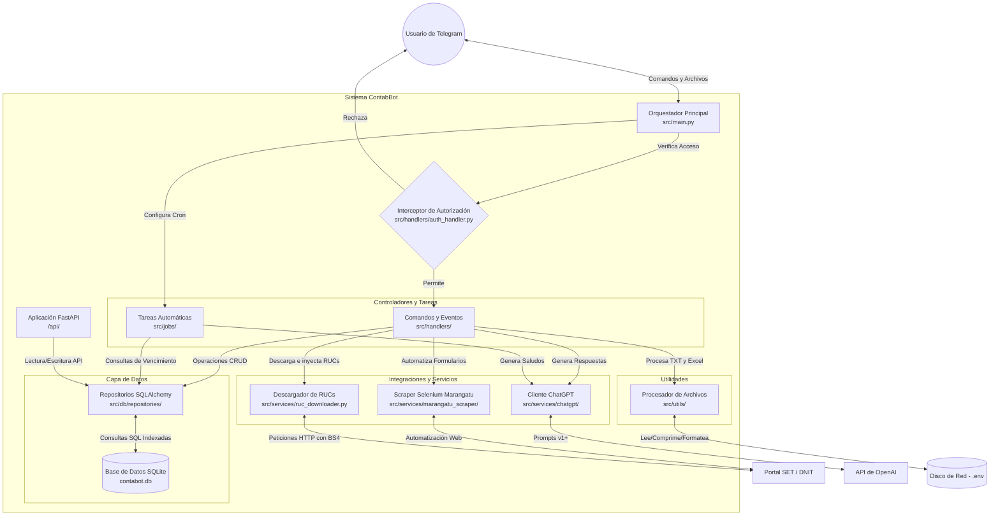

# Arquitectura de ContabBot

Este documento describe la arquitectura técnica y el flujo de datos del proyecto **ContabBot**.

## Diagrama de Arquitectura

El siguiente diagrama muestra cómo interactúan los componentes internos del sistema, así como sus dependencias con servicios externos (Telegram, OpenAI, SET/DNIT).

## Componentes Principales

1. **Telegram Bot Orquestador (`src/main.py`)**: Es el punto de entrada minimalista. Solo configura variables de entorno, inicializa la librería `python-telegram-bot` y enruta el tráfico.
2. **Interceptor de Autorización (`auth_handler.py`)**: Funciona como un candado en la capa principal (Dispatcher group -1). Verifica contra la base de datos si el usuario o grupo tiene el flag `is_active=True`. Si es `False`, bloquea instantáneamente la solicitud sin procesar el resto de la aplicación.
3. **Controladores y Tareas (`src/handlers/` y `src/jobs/`)**: 
   - **Handlers**: Módulos independientes que responden a eventos (`/export`, búsqueda mágica de nombres/RUCs, arrastrar archivos Excel).
   - **Jobs**: Tareas cronometradas que se ejecutan automáticamente (como saludos matutinos o avisos de expiración de Timbrados).
4. **Capa de Datos (`src/db/`)**: Usa **SQLAlchemy** sobre una base de datos local **SQLite** (`contabot.db`). Cuenta con repositorios para Usuarios, Grupos, Mensajes, Timbrados y Contribuyentes (RUCs), este último optimizado con inserciones masivas (*bulk_insert*) e índices relacionales para soportar millones de registros de la DNIT sin lentitud.
5. **Capa de Servicios Externos (`src/services/`)**: Agrupa todo lo que requiere una conexión a Internet.
   - **`marangatu_scraper/`**: Automatiza Firefox con Selenium para dar de baja timbrados.
   - **`ruc_downloader.py`**: Descarga, descomprime, parsea e inyecta archivos de la DNIT.
   - **`chatgpt/`**: Integración con OpenAI (v1+) para respuestas del chat.
6. **Utilidades y Procesamiento de Archivos (`src/utils/`)**:
   - Accede a discos mapeados en red a través de variables de entorno `.env`.
   - Convierte archivos Excel enviados al bot en resúmenes matemáticos HTML (`html_convert.py`).
7. **FastAPI (`/api/`)**: Aplicación en *stand-by*, desacoplada en la raíz del proyecto para posibles integraciones web futuras.

## Infraestructura y Despliegue (Docker)
El proyecto cuenta con una orquestación basada en contenedores para garantizar que el ecosistema se despliegue de manera idéntica en cualquier entorno:
- **`contabbot_app` (Python 3.11-slim)**: Contenedor principal construido a partir del `Dockerfile` raíz. Contiene el orquestador asíncrono y los manejadores.
- **`contabbot_selenium` (standalone-firefox)**: Contenedor aislado ejecutado a través de `docker-compose.yml`. Brinda una red WebDriver remota para que el bot pueda acceder a Marangatu sin abrir ventanas gráficas en el servidor host, pero exponiendo el puerto VNC (7900) para permitir monitoreos en vivo y depuración web a través del navegador del administrador.
- **Persistencia de Datos**: El archivo `docker-compose.yml` mapea volúmenes del Host directamente hacia el contenedor (como `./src/db/config`), protegiendo a `contabot.db` de ser reinicializado o borrado durante despliegues o reinicios de máquina.
